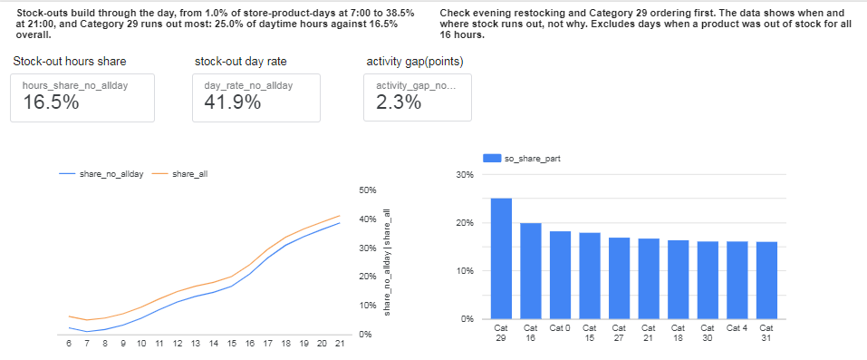
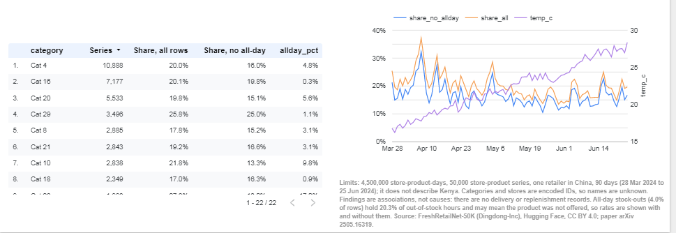

# Fresh Retail Stock-Out Analysis

## Summary
Which product categories and hours of the day have the highest stock-out rates, and what coincides with them? 4,500,000 store-product-days, 50,000 series, 28 Mar 2024 to 25 Jun 2024.

I cleaned and checked the data in pandas, measured the share of the 16 daytime hours (6:00 to 21:00) each product was out of stock, and compared hours, categories and days, with and without the 4.0% of rows that are out of stock all day.

Without all-day rows, stock-outs build through the day, from 1.0% of store-product-days out of stock at 7:00 to 38.5% at 21:00. Among the 22 categories with 100+ series, Category 29 runs out most: 25.0% of daytime hours against 16.5% overall, and 65% of its store-product-days see a stock-out. Activity days run 2.3 points higher for the same product on the same date.

Without all-day rows, the share falls from 20.5% in the first 14 days to 16.2% in the last 14, while temperature rises from 17.5 to 27.2 C, so the two cannot be separated.

The 18 cities differ little (18.9% to 22.6%); city 0 holds 51.6% of rows.

Check Category 29 first: it runs out of 25.0% of daytime hours against 16.5% overall, so ask its store managers when stock runs low and how often it is replenished. Ask the retailer for delivery and replenishment records, since this data cannot separate demand surges from supply gaps.

Limit: one retailer in China, 90 days, encoded IDs, no delivery records, so these are associations. All-day stock-outs hold 20.3% of out-of-stock hours and may mean the product was not offered.
Without all-day rows the hours share is 16.5% instead of 19.9%, and the day rate 41.9% instead of 44.3%.

## Dashboard

## Cleaning log
Cleaning log: FreshRetailNet-50K, train split (p2_01_cleaning)

1. Raw kept untouched; worked on a copy. 4,500,000 rows, 17 columns. The two hourly list columns are not
   loaded into pandas; they are checked in batches.
2. Duplicates: 0 duplicate rows and 0 duplicate store-product-days. 50,000 series, each exactly 90 days.
3. Missing values: 0 in all 17 columns.
4. Value ranges: humidity 27.35 to 100, temperature 12.06 to 30.88, wind 0.97 to 3.85, precipitation 0 to 42.5;
   holiday and activity flags only 0 or 1; no negative sales amounts. Discount ranges from 0 to 1.088:
   16,039 values are 0 and 34 are above 1. Decision: kept and flagged (disc_odd), because the stock-out
   metrics do not use discount.
5. Structure: each product belongs to 1 third-level category and each store to 1 city (maximum 1 in both checks).
6. Category hierarchy: each third-level category belongs to 1 second-level category and each second-level
   category to 1 first-level category (maximum 1 in both checks); 32 first-level categories.
7. Hourly check on all 4.5M rows: the stock-out count equals the hourly 1s in 100% of rows; statuses are only
   0 and 1; daily sales amounts equal the sum of hourly sales amounts (largest gap 4.6e-06, float32 rounding);
   0 negative hourly sales amounts.
8. sale_amount outliers: median 0.7, 99.9th percentile 20.6, maximum 44.9. 4,472 rows are above the 99.9th
   percentile. Decision: kept and flagged (sale_outlier), because the metrics use the stock-out columns,
   not sales.
9. Full-day stock-outs: 181,791 rows (4.0%) are out of stock in all 16 hours and hold 20.3% of all
   out-of-stock hours. Without them the hours share is 16.5% (not 19.9%) and the stock-out day rate 41.9%
   (not 44.3%), so the headline rates include these rows. Their sales amount is 0 in at least three quarters
   of them (mean 0.046, maximum 15.4). Possible explanation: the stock count covers hours 6 to 21 but daily
   sales cover 24 hours, so some sales may come from hours 0 to 5 or 22 to 23; to be checked in the analysis.
   Decision: kept and flagged (so_allday).
10. dt converted from text to dates; derived so_day (stock_hour6_22_cnt > 0) and so_share (count / 16).
11. ID columns downcast to small integers to save memory.
12. Reconciled: 4,500,000 rows, 50,000 series, 90 days each, stock-out hours match the hourly total.
    Stock-out day rate 0.4427, hours share 0.1988.
13. Saved as parquet in Project2_Stockout (19 MB). Not uploaded to GitHub: it is a derived file that the
    notebook rebuilds from the Hugging Face source.
14. The eval split (350,000 rows) is not used. The hourly lists stay in the source dataset for the
    hour-of-day work and were checked in batches.

## Checks and limits
- Without all-day rows the hours share is 16.5% instead of 19.9%, and the day rate 41.9% instead of 44.3%.
- Holiday and weather effects cannot be separated from the calendar.
- Categories are ranked only with 100+ series (22 of 32).
## Files
- notebooks/: cleaning and analysis
- data/summary/: the four small tables behind the dashboard
- images/: dashboard screenshots

## Data source
FreshRetailNet-50K (Dingdong), Hugging Face: Dingdong-Inc/FreshRetailNet-50K. License as stated on the dataset card; paper arXiv 2505.16319.

## How to rerun
Open the notebooks in Google Colab. Run p2_01_cleaning first: it downloads the data from Hugging Face and saves a cleaned file to Drive. Then run p2_02_analysis, which reads that file. Set the Drive folder path at the top of each notebook.
